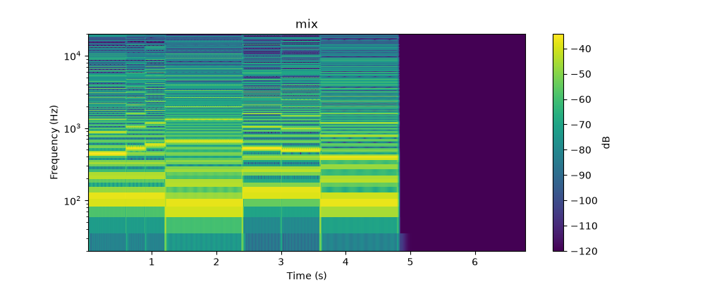

# poser

[](https://github.com/isnbh0/poser/actions/workflows/check.yml)

Write a song as code in Python or YAML. poser renders its tracks through instrument backends,
mixes the stems, and produces reports and spectrograms for a person or agent to use in revisions.
Backends include VST3 and Audio Unit instruments through
[pedalboard](https://github.com/spotify/pedalboard) and [scsynth](packages/poser-scsynth/README.md).

## Create your studio

A studio is your own project for songs, instruments, and renders. Follow the
[setup guide](docs/setup.md) to create and verify one yourself, or paste this into a coding agent
to have it help:

```text
Set up poser for me by following https://raw.githubusercontent.com/isnbh0/poser/main/docs/bootstrap.md
```

Both use the free Surge XT reference setup on macOS and can continue to your first song. An agent
asked to set up poser takes the [bootstrap prompt](docs/bootstrap.md) as its instructions.

Hear an example and get its source in the [optional showcase](docs/showcase.md).

## Surge demo

The eight-beat demo plays Surge XT's default patch on two tracks as a smoke test. Its mix and a
spectrogram per track land under `renders/songs/demo.yaml/latest/`. Play `mix.wav` to hear the
song, and see its shape at a glance:



The report that drives the next revision, abridged, with illustrative metric values. Songs author
`tracks`; the report lists each track and each effect under `nodes`:

```json
{
  "song": "demo",
  "run": 1,
  "nodes": [
    {
      "name": "lead",
      "status": "analyzed",
      "gain_db": -3.0,
      "peak_dbfs": -10.383672189873698,
      "integrated_lufs": -18.651026814438925,
      "clipped_samples": 0,
      "defects": []
    }
  ],
  "mix": {
    "peak_dbfs": -10.05617342416529,
    "integrated_lufs": -19.345337407632602,
    "spectrogram": "renders/songs/demo.yaml/latest/images/[mix].png",
    "defects": []
  }
}
```

## Configuration

`poser.toml` names the workspace's instruments. Each table under `instruments` is one
instrument, and its name is what songs write before the colon in a track's `sound`:

```toml
[instruments.surge]
adapter = "pedalboard"
path = "/Library/Audio/Plug-Ins/VST3/Surge XT.vst3"
guide = "A note about this instrument for the workspace guide."

[instruments.surge.sources]
presets = "/Library/Application Support/Surge XT/patches_factory"
```

A song names `surge` for the default patch, `surge:presets/<path without suffix>` for a preset
in a source, and `surge:saved/<name>` for a sound saved with `save-sound`. The `pedalboard`
adapter takes `path`, `plugin_name` for a bundle holding several plugins, `sources`, and
`formats`, the preset formats it reads (`fxp`, and `saved` for saved sounds, by default).
Relative paths resolve against the directory holding `poser.toml`, and `list-sounds` notes the
files in a source it cannot use.

An optional `[adapters]` table chooses the adapter for every other part of poser. Each key takes
a built-in name, an import path, or a table with `use` and options:

| Key | Default |
|---|---|
| `song_formats` | `["yaml", "script"]` |
| `record_writer` | `"yaml"` |
| `audio_files` | `"wav"` |
| `render_store` | `"files"` |
| `mixer` | `"gain"` |
| `measurer` | `"standard"` |
| `visualizer` | `"spectrogram"` |
| `sections` | `[]` |

Edit `AGENTS.md` for studio preferences and each instrument's `guide` in `poser.toml` for
instrument notes. `POSER.md` is generated from poser's core guide, instrument notes, and adapter
guides. Run `uv run update-guide` after changing `poser.toml`, and `uv run update-guide --check`
to see whether the reference is current. The command writes only `POSER.md`, and refuses to
replace one it did not generate. `CLAUDE.md` points to `AGENTS.md`.

`POSER.md` includes composition advice by default; to turn it off, see
[composition advice](docs/setup.md#composition-advice).

## Commands

- `uv run init-workspace --setup surge`: write the selected reference setup and guide into a
  directory.
- `uv run check-instruments`: check that each instrument loads and plays notes, and report whether
  two renders are sample-identical.
- `uv run list-sounds`: list every sound a song can name, with a description; filter with
  `--instrument` and `--match`, and add `--json` for JSON.
- `uv run piano-roll <song> --output <path.png>`: draw authored notes without loading plugins or
  rendering audio; `--replace` replaces an existing PNG. Load only trusted Python songs.
- `uv run render-song <song>`: render one aligned stem per track, rendering again only tracks
  whose inputs changed.
- `uv run analyze-song <song>`: mix the stems and write the report, spectrograms, and a numbered
  record of the analysis.
- `uv run export-song <song> --destination <new-directory>`: render, analyze, and publish a
  verified matching delivery; repeat `--include <source-relative-file>` for local dependencies.
- `uv run save-sound <instrument> <name> --description <text>`: open an instrument's window and
  save its state as a sound when the window closes. It waits for a person to close the window,
  so agents can't use it.
- `uv run update-guide`: write `POSER.md` from poser and `poser.toml`; `--check` only compares.

Every command but `init-workspace` takes `--config`, and those that use saved sounds or results
take `--sounds-dir` or `--output-dir`, to work outside a workspace or on another one. With
`--config`, the workspace is the directory holding that file.

## Verified delivery

Use `uv run export-song <song> --destination <new-directory>` for a matching delivery.
Export publishes editable `source/`, `audio/`, `images/`, `report.json`, and a hash manifest
only on success. Use a new destination each time and declare local source dependencies with
repeatable `--include <source-relative-file>`.

Use render and analyze while iterating. Export verifies that the delivered files match one render
and analysis, and records the bundle as not auditioned. See the
[export contract](docs/setup.md#export-contract) for guarantees, limitations, and path rules.

## Adapters of your own

Any adapter key, and an instrument's `adapter`, can name a factory by import path,
`module:attribute`:

```toml
[instruments.drums]
adapter = "studio_adapters.drums:create"
kit = "brushes"

[adapters]
sections = [{ use = "studio_adapters.sections:create", threshold = 3 }]
```

An instrument's factory takes `(name, options, context)`, the render store's takes
`(options, context, stem_suffix)`, and every other one takes `(options, context)`. Options are the
table's other keys; `context` holds the workspace root and the sounds and renders directories the
command uses. Each factory returns an object meeting its port in `poser.core.ports`, and raises
`ConfigError` for options it cannot use.

Building an adapter loads no plugin, starts no process, writes no file, and reads nothing but its
arguments and imported modules. Work with side effects waits for a method call, and a `guide`
property reads only package data. An adapter's `guide` holds required operational reference;
optional composition coaching goes in a separate `advice` property, also read from package data.
Instruments in `poser.toml` take only `guide`; an inline `advice` is a configuration error.

The module must be importable in the workspace's environment, which poser's worker processes
share. In a uv workspace, make the workspace a package (`[tool.uv] package = true` in its
`pyproject.toml`, with its modules under `src/`), or depend on a package holding the adapter.

## Developing poser

`make check` runs format, lint, types, and the tests that need no plugins. `make test-real` loads
real plugins; it reads a `poser.toml` at the repository root, so copy
`src/poser/reference_setups/surge/poser.toml` there and edit its paths first.
[AGENTS.md](AGENTS.md) describes the layout and rules. For controlled composition experiments, see
[advice ablation](docs/ablation.md).

## License

poser is licensed under GPL-3.0-or-later; see [LICENSE](LICENSE). poser depends on pedalboard,
which is GPL-3.0. The instruments you load keep their own licenses.
